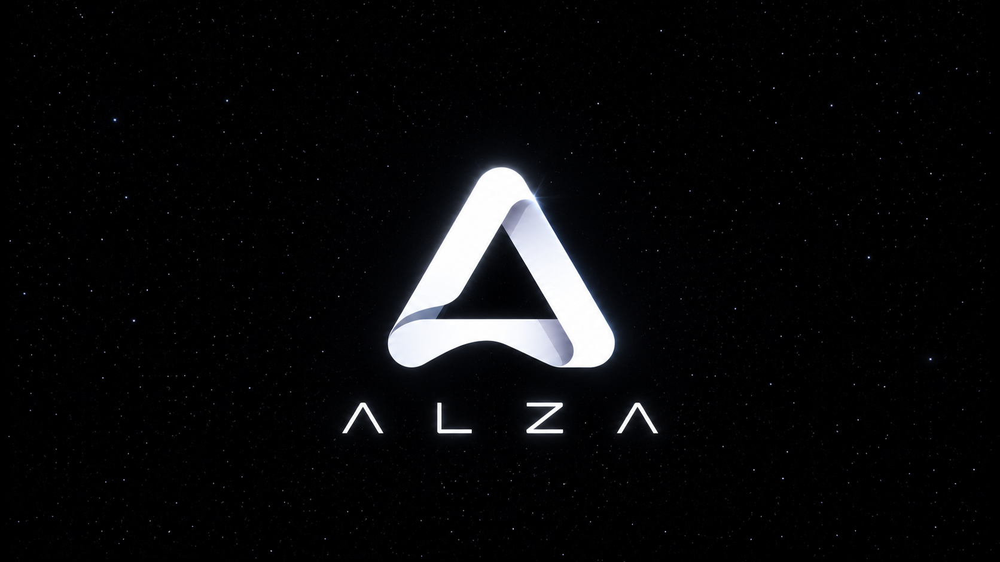
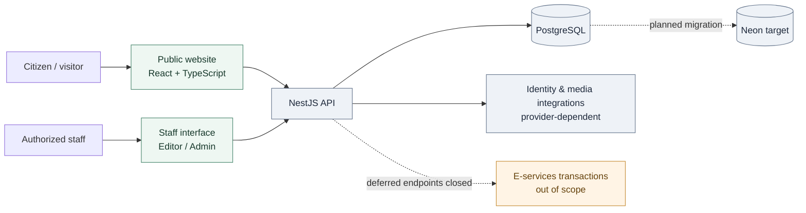

<div align="center">



<br />

# TAL.GOV

### Talibon Municipal Information Platform

**A citizen-first digital experience for the Municipality of Talibon, Bohol.**

Reliable public information. Clear municipal service guidance. Responsible content administration.

<br />

[](#delivery-status)
[](#production-readiness)
[](#current-scope)

<br />

[**Explore the platform**](#overview) &nbsp;·&nbsp; [**Architecture**](#architecture) &nbsp;·&nbsp; [**Developer guide**](#local-development) &nbsp;·&nbsp; [**Engineering standards**](#engineering-standards) &nbsp;·&nbsp; [**Project documents**](#documentation)

</div>

---

## Overview

**TAL.GOV** is a municipal web platform designed to make essential information easier to discover, understand, and maintain. It brings public-facing municipal content and controlled staff administration into one maintainable system.

The **R2 reduced-scope direction** prioritizes dependable information delivery and a focused content-management experience over launching unverified online government transactions.

<table>
<tr>
<td width="33%" valign="top">

**01 / Citizens first**

Accessible municipal information, office guidance, announcements, and downloadable resources.

</td>
<td width="33%" valign="top">

**02 / Staff-managed content**

Controlled photo and document management for authorized editors and administrators.

</td>
<td width="33%" valign="top">

**03 / Built for continuity**

Documented architecture, migration work, access controls, testing, and release gates.

</td>
</tr>
</table>

> [!IMPORTANT]
> **Scope is intentionally limited.** Online applications, permit submission, payments, transaction tracking, and related citizen workflows are deferred. The E-services area provides an informational **“To Be Implemented”** experience rather than a working transaction service. Do not present deferred functionality as available.

## Delivery status

| Workstream | Current documented position |
| :-- | :-- |
| **R2 discovery / planning** | Architecture, scope, work packages, and acceptance documentation prepared. |
| **Deferred E-services shutdown** | Increment 1 implementation documented; hosted shutdown verification remains pending. |
| **Neon database foundation** | Increment 2 database/migration and verification work documented; target integration is not proof of live cutover. |
| **Public website and staff access** | Preserved application capabilities; confirm actual environment behavior before release claims. |
| **Production release** | **Not qualified.** Deployment, hosted checks, and production acceptance must be independently verified. |

The repository includes both **implemented work** and **proposed target architecture**. A passing local test or documented increment is not equivalent to a live production release.

**Evidence and decision trail:** [R2 architecture](docs/r2/ARCHITECTURE.md) · [Work package register](docs/r2/WORK_PACKAGE_REGISTER.md) · [Increment 1 report](docs/r2/INCREMENT_1_REPORT.md) · [Production acceptance](docs/r2/PRODUCTION_ACCEPTANCE.md)

## Current scope

| Area | R2 intent | Boundary |
| :-- | :-- | :-- |
| **Public information** | Municipal content, offices, service guidance, contact and downloadable information | Publish only verified municipal information. |
| **E-services** | Informational placeholder | No citizen applications, checkout, payment returns, or tracking. |
| **Content administration** | Photos and documents | Do not assume news, services, or department editing are in the approved CMS scope. |
| **Staff access** | Editor and administrator workflows | Enforce roles server-side. |
| **Database transition** | Migrate toward Neon PostgreSQL | Target state, not evidence of completed deployment or auth/storage replacement. |
| **Future integrations** | Separately proposed and assessed | Out of current release scope. |

## Technology

<div align="center">


</div>

| Layer | Preserved / documented stack | R2 direction |
| :-- | :-- | :-- |
| **Frontend** | React, TypeScript, Vite, Tailwind CSS | Responsive public information and staff UI |
| **Backend** | NestJS, TypeScript, REST APIs | Closed deferred endpoints and bounded staff/public contracts |
| **Data** | PostgreSQL with existing Supabase integration | Neon PostgreSQL migration and controlled cutover |
| **Identity & media** | Existing Supabase-related integrations in preserved stack | Replacement must be explicitly designed and verified; Neon alone does not replace object storage or identity services |
| **Engineering** | Git, GitHub, documented tests and review gates | Evidence-driven release qualification |

> [!NOTE]
> The table distinguishes **current repository history** from **target design**. Do not assume Neon authentication, object storage, or hosted cutover are already operational.

## Architecture



The diagram is **conceptual**, not a deployed-infrastructure attestation. Refer to [the architecture record](docs/r2/ARCHITECTURE.md) for migration boundaries and design decisions.

## Repository guide

```text
.
├── frontend/          # Public site and staff-facing UI
├── backend/           # API, authorization, and service logic
├── docs/              # Architecture, handoffs, decisions, release evidence
│   └── r2/            # R2 scope, migration, and qualification records
└── README.md          # Project entry point
```

Additional database, test, automation, and operational files may vary by branch. The structure above is a **navigation guide**, not a complete verified file inventory.

## Local development

**Prerequisites:** Git, a compatible Node.js installation, and the environment access required for the branch you are working on. Use the lockfile and package manager defined in each project directory.

```bash
git clone https://github.com/azinamouto/Talibon-Official-Website-BetaTest-V1.5.git
cd Talibon-Official-Website-BetaTest-V1.5
```

Install dependencies inside the relevant application directories:

```bash
cd frontend
npm install
npm run dev
```

For the API, use a **separate terminal**:

```bash
cd backend
npm install
npm run start:dev
```

> [!NOTE]
> Commands above reflect the documented frontend/backend workflow. **Check the actual `package.json` scripts, lockfiles, and environment examples on your branch** before running them. Configure provider credentials only from approved, current environment documentation; old Supabase values are not a Neon migration guide.

> [!CAUTION]
> Never commit `.env`, `.env.local`, provider service-role keys, database passwords, session secrets, private municipal records, or exported production data. Frontend `VITE_` variables are shipped to the browser and must never contain secrets.

## Documentation

| Resource | Purpose |
| :-- | :-- |
| [R2 architecture](docs/r2/ARCHITECTURE.md) | System direction, constraints, and migration design |
| [R2 work package register](docs/r2/WORK_PACKAGE_REGISTER.md) | Increment scopes and delivery tracking |
| [Deferred workflow shutdown](docs/r2/DEFERRED_WORKFLOW_SHUTDOWN.md) | Contract for disabling citizen transaction workflows |
| [Increment 1 report](docs/r2/INCREMENT_1_REPORT.md) | Implementation and verification evidence |
| [Production acceptance](docs/r2/PRODUCTION_ACCEPTANCE.md) | Release requirements and outstanding qualification |
| [Sprint 2 API](backend/SPRINT2_API.md) | Historical API contracts |
| [Admin API](backend/docs/admin-api.md) | Administrative endpoint reference |
| [RBAC matrix](backend/docs/admin-rbac.md) | Role and permission reference |

When available in the running backend, developer API documentation is exposed through `/api/docs` and `/api/openapi.json`. Availability may differ by build or environment.

## Engineering standards

**Build what is verified. Validate what is implemented. Design what is unknown. Never fabricate government data.**

| Principle | Working expectation |
| :-- | :-- |
| **Verified public content** | Publish municipal details only after validation with the responsible source. |
| **Least privilege** | Check permissions in API and data access layers, not just interface controls. |
| **Scope discipline** | Deferred workflows stay unavailable until separately authorized and qualified. |
| **Safe change management** | Review migrations, external integrations, and environment changes before applying them. |
| **Evidence over claims** | Record test results, remaining risks, and verification limits. |
| **Accessible by design** | Support readable content, responsive layouts, keyboard access, and sensible error states. |
| **Operational continuity** | Define backup, recovery, monitoring, and rollback requirements before launch. |

### Contribution workflow

1. Start from the team-approved base branch and create a focused feature or fix branch.
2. Keep the change within its approved scope; include relevant tests and documentation.
3. Run the checks applicable to the modified packages and record actual results.
4. Open a pull request documenting **what changed, why, verification, risks, and rollback considerations**.
5. Merge only after required reviews and gates. **Never equate a merged PR with production acceptance.**

Use descriptive commits, for example `feat: ...`, `fix: ...`, `docs: ...`, `test: ...`, `refactor: ...`, or `chore: ...`.

## Production readiness

A production claim requires evidence for all applicable gates, including:

- [ ] Approved current scope and public content are verified.
- [ ] Deferred APIs, payment returns, and hosted paths are confirmed closed.
- [ ] Authentication, authorization, and media access policies are validated.
- [ ] Database migrations and data reconciliation have passed on the intended environment.
- [ ] Dependency, security, functional, and regression checks meet release criteria.
- [ ] Deployment configuration, domain/HTTPS, monitoring, backups, and recovery are tested.
- [ ] Responsible stakeholders approve release and any known exceptions are documented.

**Status: production qualification pending.** Refer to the [acceptance record](docs/r2/PRODUCTION_ACCEPTANCE.md) for authoritative project-specific criteria and evidence.

## Direction

TAL.GOV is being shaped as a dependable **municipal information foundation**. Further digital services may be reconsidered through separate requirements, government approval, security review, and delivery qualification—not as implicit capabilities of the current release.

---

<div align="center">

**WE FIND. WE SOLVE. WE LIFT. — ALZA**

<sub>Developed and maintained by the TAL.GOV development team · Talibon, Bohol, Philippines</sub>

<br /><br />

<sub>Citizen-first design · Verified information · Responsible engineering</sub>

</div>
