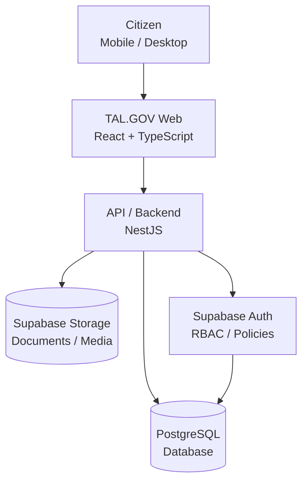
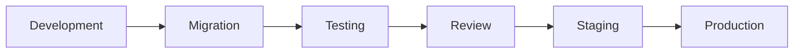
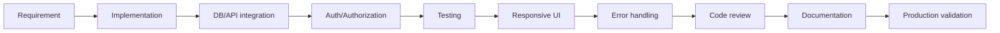
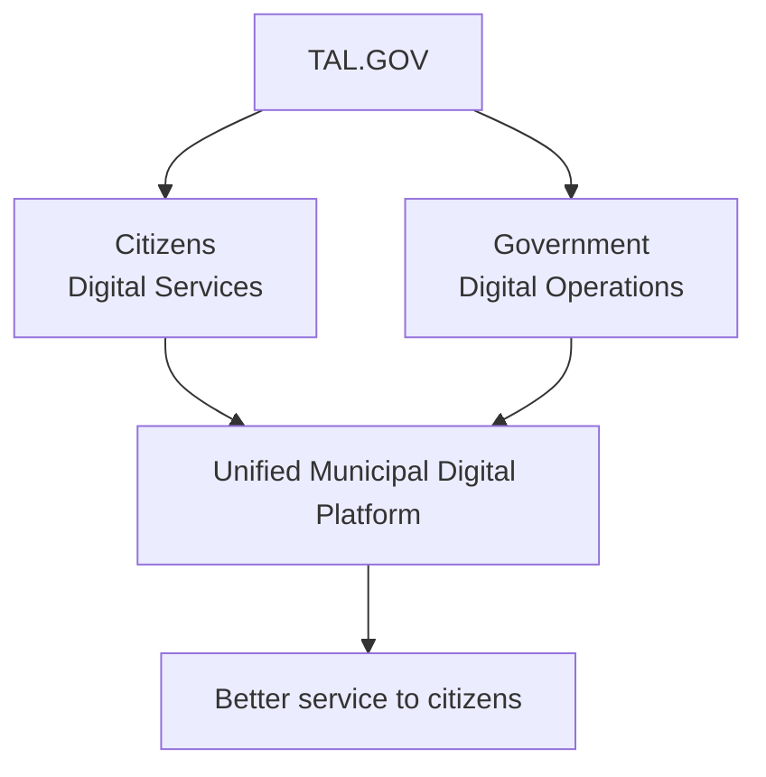

<div align="center">

<!-- Banner image: save as docs/assets/banner.png -->


<br />

# TAL.GOV
### Digital Talibon Municipal Platform

**The official digital platform of the Municipality of Talibon, Bohol**
*Secure • Accessible • Maintainable • Scalable*

<br />


[Overview](#overview) •
[Architecture](#system-architecture) •
[Getting Started](#getting-started) •
[Modules](#core-modules) •
[Security](#security-requirements) •
[Roadmap](#delivery-roadmap) •
[Contributing](#contributing)

</div>

---

## Backend Documentation

| Document | Description |
|---|---|
| [Sprint 2 API](backend/SPRINT2_API.md) | Pages, news and services contracts |
| [Admin API](backend/docs/admin-api.md) | Sprint 4 — admin reports and user management |
| [RBAC Matrix](backend/docs/admin-rbac.md) | Sprint 4 — role and permission matrix |
| Swagger UI | `/api/docs` on the running backend |
| OpenAPI spec | `/api/openapi.json` on the running backend |

---

## Table of Contents

1. [Overview](#overview)
2. [Project Goals](#project-goals)
3. [Technology Stack](#technology-stack)
4. [System Architecture](#system-architecture)
5. [Repository Structure](#repository-structure)
6. [Getting Started](#getting-started)
7. [Git Workflow & Commit Convention](#git-workflow--commit-convention)
8. [Core Modules](#core-modules)
9. [User Roles](#user-roles)
10. [Security Requirements](#security-requirements)
11. [Database & API Requirements](#database--api-requirements)
12. [Quality Goals](#quality-goals)
13. [Testing](#testing)
14. [Production Checklist](#production-deployment-checklist)
15. [Definition of Done](#definition-of-done)
16. [Delivery Roadmap](#delivery-roadmap)
17. [Success Metrics](#success-metrics)
18. [Development Principles](#development-principles)
19. [Contributing](#contributing)

---

## Overview

**TAL.GOV** gives citizens, visitors, municipal employees and administrators a centralized, reliable source of municipal information and digital services.

The goal is to turn the traditional municipal website into a **service-oriented digital government platform**, not just a static information site.

<table>
<tr>
<td>

**Information**
- Municipal information
- News & announcements
- Emergency information
- Departments & offices

</td>
<td>

**Services**
- Government services
- Guides & requirements
- Citizen concerns & requests
- Digital documents & media

</td>
<td>

**Administration**
- Content management (CMS)
- Role-based access control
- Secure authentication
- Future municipal integrations

</td>
</tr>
</table>

---

## Project Goals

> **Primary goal:** build a **secure, accessible, maintainable, and scalable** digital government platform that improves how the Municipality of Talibon publishes information and delivers services.

| # | Goal | What it means |
|---|---|---|
| 1 | **Citizen accessibility** | Services, requirements, fees, processing times, office locations, contacts, announcements, emergency info and programs — on any modern device |
| 2 | **Digital service delivery** | Move from informational pages toward structured workflows: online requests, concern reporting, application tracking, appointments, document requests, feedback, notifications |
| 3 | **Centralized information** | One authoritative source; authorized staff update content without developer involvement |
| 4 | **Administrative efficiency** | Manage services, departments, news, announcements, documents, media, users, submissions and system content |
| 5 | **Security** | Authentication, authorization, RBAC, Row Level Security, secure policies, protected routes, validation, secure storage, secrets protection, auditability |
| 6 | **Scalability** | Grow into a broader Municipal Digital Government Platform without a rewrite |

---

## Technology Stack

| Layer | Technologies |
|---|---|
| **Frontend** | React · TypeScript · Vite · Tailwind CSS · Responsive UI |
| **Backend** | NestJS · TypeScript · REST API · Validation & business logic |
| **Database** | PostgreSQL · Supabase · Relational architecture |
| **Authentication** | Supabase Auth · Email/password · Role-based authorization · Protected admin routes |
| **Storage** | Supabase Storage — documents, images, news media, service attachments, approved assets |
| **Dev Tools** | Git · GitHub · VS Code · pnpm/npm · Postman · Browser DevTools |

---

## System Architecture



---

## Repository Structure

> The exact structure may evolve, but should follow a clear separation of concerns.

```text
TALIBON-Official-Website/
│
├── frontend/                # React + Vite app
│   ├── src/
│   │   ├── components/
│   │   ├── pages/
│   │   ├── layouts/
│   │   ├── hooks/
│   │   ├── services/
│   │   ├── types/
│   │   ├── utils/
│   │   └── assets/
│   ├── public/
│   ├── package.json
│   └── vite.config.ts
│
├── backend/                 # NestJS API
│   ├── src/
│   │   ├── modules/
│   │   ├── controllers/
│   │   ├── services/
│   │   ├── guards/
│   │   ├── middleware/
│   │   └── main.ts
│   └── package.json
│
├── database/                # Migrations, schemas, seeds
│   ├── migrations/
│   ├── schemas/
│   └── seed/
│
├── docs/                    # Architecture, API, deployment, security
│   ├── architecture/
│   ├── api/
│   ├── deployment/
│   └── security/
│
├── .env.example
├── .gitignore
└── README.md
```

> [!WARNING]
> Keep secrets, credentials, production environment files and private municipal data **outside Git**.

---

## Getting Started

### Step 1: Requirements

- Node.js
- Git
- VS Code
- PostgreSQL / Supabase access
- pnpm or npm

```bash
node --version
npm --version
git --version
pnpm --version   # if using pnpm
```

### Step 2: Clone & install

```bash
git clone <REPOSITORY_URL>
cd <PROJECT_DIRECTORY>

npm install      # or: pnpm install
```

### Step 3: Configure environment

```bash
cp .env.example .env
```

<details>
<summary><b>Windows PowerShell</b></summary>

```powershell
Copy-Item .env.example .env
```

</details>

```env
VITE_SUPABASE_URL=
VITE_SUPABASE_ANON_KEY=

SUPABASE_URL=
SUPABASE_SERVICE_ROLE_KEY=

DATABASE_URL=

API_URL=
PORT=
```

> [!CAUTION]
> **Never commit:** `.env`, `.env.local`, `.env.production`
>
> **Never expose:** `SUPABASE_SERVICE_ROLE_KEY`, `DATABASE_PASSWORD`, `PRIVATE_API_KEYS`, `JWT_SECRETS`
>
> Only public client-side values may be exposed through frontend (`VITE_`) variables.

### Step 4: Run the development environment

| Service | Command | URL |
|---|---|---|
| Frontend | `npm run dev` | http://localhost:5173 |
| Backend | `npm run start:dev` | Depends on `PORT` in your environment config |

---

## Git Workflow & Commit Convention

`main` is the stable, production-ready branch. **Do not develop experimental features directly on `main`.**

```text
main
 ├── develop
 │    ├── feature/service-routing
 │    ├── feature/cms-services
 │    ├── feature/authentication
 │    └── fix/mobile-navigation
 └── release/*
```

```bash
git checkout main
git pull origin main
git checkout -b feature/my-feature

# ...develop...

git status
git add .
git commit -m "feat: add municipal service routing"
git push -u origin feature/my-feature
```

Then open a **Pull Request** for review.

### Commit messages

| Prefix | Example |
|---|---|
| `feat` | `feat: add service detail routing` |
| `fix` | `fix: resolve mobile navigation issue` |
| `refactor` | `refactor: simplify service data layer` |
| `docs` | `docs: update deployment instructions` |
| `style` | `style: improve service card layout` |
| `test` | `test: add service routing tests` |
| `chore` | `chore: update dependencies` |
| `security` | `security: restrict admin storage policy` |

Avoid: `update`, `final`, `final2`, `asdf`, `changes`, `works`

---

## Core Modules

### Public Website

- [ ] Home
- [ ] About Talibon
- [ ] Municipal Officials
- [ ] Departments and Offices
- [ ] Government Services
- [ ] Service Details
- [ ] Requirements
- [ ] Fees
- [ ] Processing Time
- [ ] Contact Information
- [ ] News
- [ ] Announcements
- [ ] Events
- [ ] Downloadable Documents
- [ ] Emergency Information
- [ ] Search

### Municipal Services

Every service has **structured** information:

```text
Service
├── Service Name
├── Department
├── Description
├── Eligibility
├── Requirements
├── Steps
├── Fees
├── Processing Time
├── Office Location
├── Contact Information
├── Availability
└── Related Documents
```

Avoid hard-coded, unstructured HTML for service data. Structured data enables CMS management, search, filtering, future APIs, analytics, service status and online application workflows.

### CMS / Administration

Authorized municipal personnel manage content through an admin interface.

- [ ] Create content
- [ ] Edit content
- [ ] Publish content
- [ ] Unpublish content
- [ ] Archive content
- [ ] Upload documents
- [ ] Manage images
- [ ] Manage services
- [ ] Manage departments
- [ ] Manage announcements
- [ ] Manage news
- [ ] Manage users
- [ ] View system activity

---

## User Roles

The system follows **least-privilege** access.

| Role | Scope |
|---|---|
| `super_admin` | Full system administration |
| `admin` | General platform administration |
| `editor` | Content creation and editing |
| `municipal_admin` | Municipal-level administration |
| `barangay_admin` | Barangay-specific management |

> [!IMPORTANT]
> Permissions must be enforced at the **backend/database level**, not only by hiding UI elements.

---

## Security Requirements

> Security is a **production requirement**, not an optional enhancement.

Before production deployment:

- [ ] Authentication is implemented
- [ ] Authorization is enforced
- [ ] Protected routes are verified
- [ ] RLS policies are reviewed
- [ ] Storage policies are reviewed
- [ ] Admin privileges are restricted
- [ ] Sensitive environment variables are protected
- [ ] Input validation is implemented
- [ ] API endpoints are protected
- [ ] File upload restrictions are implemented
- [ ] Database permissions are reviewed
- [ ] Error messages do not expose sensitive information
- [ ] Production secrets are rotated when necessary
- [ ] Dependency vulnerabilities are reviewed
- [ ] Backup and recovery procedures are documented

---

## Database & API Requirements

### Database

- Normalized relational design with foreign key integrity
- Appropriate indexes and clear naming conventions
- UUIDs where appropriate
- Timestamp tracking and soft deletion where appropriate
- RLS policies
- **Migration-based** schema changes (never modify production structures without a documented migration)



### API

Clear, predictable REST endpoints. Admin endpoints require authorization; public endpoints expose only information intended for the public.

```text
GET    /api/services
GET    /api/services/:id
POST   /api/services
PATCH  /api/services/:id
DELETE /api/services/:id

GET    /api/departments
GET    /api/news
GET    /api/announcements
```

---

## Quality Goals

<table>
<tr>
<td valign="top" width="33%">

### Performance
- Fast initial page load
- Responsive mobile experience
- Optimized, lazy-loaded images
- Efficient queries
- Minimal API requests
- Proper caching
- Optimized production builds

> A citizen on an average mobile device and ordinary Philippine internet connection should reach essential information quickly and reliably.

</td>
<td valign="top" width="33%">

### Accessibility
- [ ] Keyboard navigation
- [ ] Proper heading hierarchy
- [ ] Accessible forms
- [ ] Alt text for meaningful images
- [ ] Sufficient color contrast
- [ ] Visible focus states
- [ ] Responsive text
- [ ] Screen-reader-friendly navigation
- [ ] Clear error messages

</td>
<td valign="top" width="33%">

### SEO
- Unique titles & meta descriptions
- Canonical URLs
- Open Graph metadata
- Structured headings
- Sitemap & robots configuration
- Indexable public content

- Good: `/services/business-permit`
- Good: `/departments/municipal-health-office`
- Avoid: `/page?id=173`

</td>
</tr>
</table>

---

## Testing

Before merging significant features:

| Area | Checks |
|---|---|
| **Functional** | Works as intended · loading, empty and error states · invalid input handled · mobile & desktop layouts |
| **Security** | Unauthorized users blocked · no access to others' restricted data · admin endpoints enforce roles · storage policies hold |
| **Regression** | Authentication · navigation · services · CMS · database operations · mobile responsiveness |

---

## Production Deployment Checklist

<details>
<summary><b>Application</b></summary>

- [ ] Production build succeeds
- [ ] No console errors
- [ ] No broken routes
- [ ] No placeholder content
- [ ] No development credentials
- [ ] No debug endpoints exposed

</details>

<details>
<summary><b>Database</b></summary>

- [ ] Production schema verified
- [ ] RLS verified
- [ ] Database indexes reviewed
- [ ] Backup configured
- [ ] Migration history documented

</details>

<details>
<summary><b>Authentication</b></summary>

- [ ] Login tested
- [ ] Logout tested
- [ ] Password recovery tested
- [ ] Role permissions tested
- [ ] Protected routes tested

</details>

<details>
<summary><b>CMS</b></summary>

- [ ] Editors can manage content
- [ ] Unauthorized users cannot modify content
- [ ] Media uploads work
- [ ] Publishing workflow works

</details>

<details>
<summary><b>Infrastructure</b></summary>

- [ ] Domain configured
- [ ] HTTPS enabled
- [ ] Production environment variables configured
- [ ] Error monitoring configured
- [ ] Backup strategy documented
- [ ] Recovery procedure documented

</details>

<details>
<summary><b>Public Website</b></summary>

- [ ] Mobile tested
- [ ] Desktop tested
- [ ] Accessibility reviewed
- [ ] SEO reviewed
- [ ] Search tested
- [ ] Contact information verified
- [ ] Municipal information verified

</details>

---

## Definition of Done

A feature is **DONE** only when it has passed every stage — not just "it works on my machine."



---

## Delivery Roadmap

| Phase | Focus | Deliverable |
|---|---|---|
| **1 — Foundation** | Architecture, database schema, authentication, role system, RLS policies, core UI system, deployment environments | Stable technical foundation |
| **2 — Public Website** | Homepage, About, Officials, Departments, Services & details, News, Announcements, Documents, Contact, Search | Production-ready public municipal website |
| **3 — CMS** | Admin dashboard; service, news, announcement, department, document, media and user management | Municipal Content Management System |
| **4 — Citizen Services** | Concern reporting, requests, application tracking, notifications, feedback, digital forms, status tracking | Citizen-facing digital service platform |
| **5 — Enterprise Integration** | HRIS, citizen services, document management, payments, emergency response, barangay systems, analytics | Unified Municipal Digital Platform |

<details>
<summary><b>Phase checklists</b></summary>

**Phase 1 — Foundation**
- [ ] Project architecture finalized
- [ ] Database schema finalized
- [ ] Authentication finalized
- [ ] Role system finalized
- [ ] RLS policies finalized
- [ ] Core UI system finalized
- [ ] Deployment environments configured

**Phase 2 — Public Municipal Website**
- [ ] Homepage · About Talibon · Officials · Departments
- [ ] Services · Service details · News · Announcements
- [ ] Documents · Contact · Search

**Phase 3 — CMS**
- [ ] Admin dashboard
- [ ] Service · News · Announcement · Department management
- [ ] Document · Media · User management

**Phase 4 — Citizen Services**
- [ ] Citizen concern reporting · Request submission
- [ ] Application tracking · Notifications
- [ ] Citizen feedback · Digital forms · Service status tracking

**Phase 5 — Municipal Enterprise Integration**
- [ ] HRIS · Citizen Services · Document Management · Payment Systems
- [ ] Emergency Response · Barangay Systems · Analytics · Other systems

</details>

---

## Success Metrics

Success is measured by **outcomes**, not the number of pages created.

| Citizen Experience |  Municipal Operations |  Technical |
|---|---|---|
| Less time to find information | Less manual publishing | High availability |
| More mobile access | Faster content updates | Low error rate |
| More use of digital services | Centralized information | Secure authentication |
| Fewer repetitive inquiries | Better service visibility | Strong data integrity |
| | Improved internal workflows | Maintainable, documented code |
| | | Reliable deployment process |

---

## Development Principles

| Principle | Meaning |
|---|---|
| **Security First** | Government systems handle information that must be protected |
| **Citizen First** | Every feature must deliver measurable value to citizens or operations |
| **API First** | Business logic is not coupled to a single interface |
| **Data Driven** | Municipal information is structured and queryable |
| **Maintainability** | Future developers and municipal IT staff can understand and maintain it |
| **Scalability** | Supports future municipal systems without unnecessary rewrites |
| **Accessibility** | Government information is accessible to everyone |
| **Transparency** | Behavior, data ownership and responsibilities are clearly documented |

### Production readiness standard

TAL.GOV is **not** production-ready until it is:

`Functional` `Secure` `Tested` `Responsive` `Accessible` `Documented` `Backed up` `Monitorable` `Recoverable` `Maintainable`

---

## Contributing

```bash
git status
git pull origin main
git checkout -b feature/<feature-name>

# implement and test, then:
git add .
git commit -m "feat: <description>"
git push -u origin feature/<feature-name>
```

Open a Pull Request that describes:

1. What changed
2. Why it changed
3. What was tested
4. Any database changes
5. Any environment changes
6. Any known limitations

---

## Vision



> **TAL.GOV is meant to evolve from a municipal website into a digital government platform.**

<div align="center">

### Build it secure. Build it maintainable. Build it for the citizens. Build it to last.

<br />

**Current Status:** Active Development<br />
**Next Priority:** Production foundation · public municipal services · CMS · authentication/authorization · database security · testing · deployment pipeline

<br />

**Maintained by the TAL.GOV Development Team**
Municipality of Talibon · Bohol, Philippines

</div>