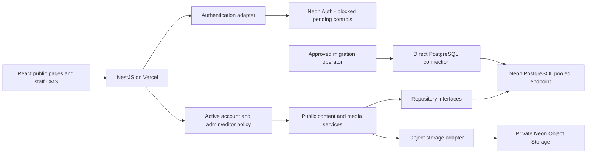

# Increment 2 implementation addendum

The backend now includes an unmounted `pg` database module, repository interfaces, versioned schema/grants, and isolated migration/reconciliation/recovery tooling. No route or frontend switches provider. PostgreSQL 17+ is required; local verification uses PostgreSQL 18. See [implemented contracts and operations](DATABASE_OPERATIONS.md) and [Increment 2 evidence](INCREMENT_2_REPORT.md). Authentication, storage, retained-route cutover and hosted qualification remain gated. The historical design below remains a record, not a claim that its entire proposed model is implemented.

# Increment 1 implementation addendum

The current repository now enforces scope reduction using an early, unconditional 410 middleware shared by standalone and serverless NestJS startup. Forms/payment/notification/chat providers are unbound; a separate public-forms controller retains informational reads without the writable forms service. Public `/forms/*` and `/payment/*` paths render the exact E-services placeholder. Public content, search, staff authentication/account administration and security activity reports remain on the R1 provider stack.

The service directory and detail pages were inspected and are already read-only, so they remain to preserve office information. Broad editing tabs/mutations, citizen signup, notification UI, chatbot and GAD profiling entry points are retired. History remains in Git and unmounted source. No new runtime dependencies, provider adapters or migrations were introduced. See [endpoint and job inventory](DEFERRED_WORKFLOW_SHUTDOWN.md) and [Increment 1 report](INCREMENT_1_REPORT.md). Hosted direct-provider access is not certified closed by this application change.

The Increment 0 architecture below is preserved as the original design record; its statements about runtime being unchanged describe Increment 0 only.

# TalGov R2 architecture — Increment 0

Status: discovery and design implemented; runtime migration not implemented. Evidence date: 2026-11-01 (Asia/Shanghai). This is not production qualification.

## Baseline and preservation

The requested repository is `Talibon-Official-Website-BetaTest-V1.5`, remote `rynzz22/Talibon-Official-Website-BetaTest-V1.5`. The initial IDE workspace, TAGAD-FOUNDATION, is a different application and was not modified.

R1 is committed on `hardening/production-readiness-r1` at `fd2fe689b2f442f22409ca9c7a2699e3cd0c25be`. Both tracked and untracked status were empty before this increment. Recent commits include `a790fda` (headers/gates), `8885bec` (official-data release validation), `e4987f8` (privacy notice), and `faa4c41` (unavailable services). No uncommitted TalGov R1 modifications were found. Merge, remote CI and live deployment status were not verified.

An isolated worktree was created at `C:/Users/admin/Documents/TalGov-R2-Increment-0` on `docs/talgov-r2-increment-0`, based on that exact SHA. The original R1 branch/worktree remains intact. No reset, stash, merge, deployment, database migration or credential transfer occurred. See [increment report](INCREMENT_0_REPORT.md).

## Observed architecture

- React 19 / TypeScript / Vite; route composition in `frontend/src/App.tsx`.
- NestJS 11, `backend/src/app.module.ts`, with a combined Vercel deployment through `api/index.js`, `backend/src/serverless.ts` and root `vercel.json`.
- Supabase database, auth and storage. Backend services use its service-role client; `AboutService` also constructs a separate SDK client. Browser services perform direct reads/writes and storage uploads.
- The routed admin UI is `SprintAdminDashboard.tsx`, editing pages/news/services and managing users/reports. The much larger `AdminDashboard.tsx` is not the dashboard imported by the router; its media UI cannot be assumed to be the working R2 CMS.
- R1 verifies auth identity, live session existence and profile authorization on privileged API requests. It blocks public checkout, but forms, signup, notification processing and their database paths remain present.
- The eight-file canonical SQL chain contains 27 public table declarations, three views and 30 distinct function names. This is a source inventory, not proof of the deployed schema. Historical SQL is incompatible in places; see [database design](DATABASE_SCHEMA.md).

## Proposed R2 boundaries

Keep the existing application and public presentation. Introduce Nest injection tokens for `PublicContentRepository`, `MediaRepository`, `StaffRepository`, `AuditRepository`, `AuthenticationAdapter` and `ObjectStore`. Controllers validate HTTP contracts; services enforce policy and transactions; only adapters know provider APIs. Do not reproduce PostgREST chaining under a renamed service.

Use standard PostgreSQL parameterized SQL through a small `pg` adapter as the proposed initial driver. It is not yet installed or qualified. Keep a small pool per warm function, use one checked-out connection per transaction, and keep migrations outside request startup. [Connection policy](NEON_MIGRATION_PLAN.md) defines proposed budgets and failure behavior.

Keep public route shapes and DTOs where compatible. Approved content moves through backend repositories; frontend code must have no direct database access in R2. Source-held municipal text may remain source-held after owner review; migration must not convert it into newly verified official records. Do not replace missing content with fabricated data.

Staff identity and roles are distinct: Neon verifies identity/session; application-owned staff records grant only `admin` or `editor`. No provider user metadata, browser role field or existing role name automatically grants access. Privileged account provisioning stays an operator/admin function.

The preferred production topology remains one browser origin with `/api` on Vercel. This does **not** establish that Neon Auth cookies can be securely validated by NestJS. That integration requires a documented, tested provider flow before implementation; see [provider gates](AUTH_AND_STORAGE_CONTRACTS.md). No self-hosted auth or other storage provider is silently substituted.

## Decisions and tradeoffs

| Decision | Reason / consequence |
|---|---|
| Only discovery in Increment 0 | All API/DB contracts below are proposed; R1 behavior remains unchanged |
| Separate retained public data from writable media metadata | Preserve public content without expanding news/page editing scope |
| Private media objects; authorize reads using publication metadata | A draft must not be exposed by a public bucket URL |
| Upload to quarantine, validate server-side, then finalize | Browser MIME checks and signed upload possession are insufficient |
| Transactional mutation and audit event | Existing response-finish audit is useful telemetry, not atomic CMS accountability |
| Versioned SQL and explicit migration ledger | No automatic schema synchronization, no production startup migrations |
| No runtime fallback to Supabase in final R2 | Provider outages fail closed; legacy history may remain excluded |
| No deployment while auth/storage gates are unresolved | Partial replacement is not a zero-Supabase production application |

## Reading order and status vocabulary

[Scope](SCOPE.md), [dependency inventory](SUPABASE_DEPENDENCY_INVENTORY.md), [database schema](DATABASE_SCHEMA.md), [migration plan](NEON_MIGRATION_PLAN.md), [auth/storage contracts](AUTH_AND_STORAGE_CONTRACTS.md), [security](SECURITY_MODEL.md), [acceptance](PRODUCTION_ACCEPTANCE.md), [recovery](ROLLBACK_AND_RECOVERY.md), [work packages](WORK_PACKAGE_REGISTER.md).

**Implemented** means present in the reviewed files. **Tested** requires an execution record. **Blocked** identifies a missing capability or prerequisite. **Pending credentials** means a target-specific check has not been possible. **Pending approval** means a named municipal/operator decision is needed. **Not yet verified** covers unevaluated behavior. A proposed design is not an implemented or tested capability.
